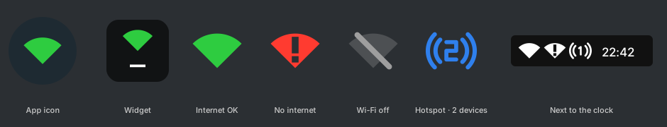

# WiFi Dot

A tiny Android app that shows whether your **Wi-Fi actually has internet**, not just whether you are connected.
Built with Starlink in mind: one tap opens the dish status page.



**[Download WiFiDot.apk (v3.1)](https://github.com/volodymyr-sokolov/wifi-dot/raw/main/release/WiFiDot.apk)**. Open it on the phone and allow installing from unknown sources.

| Icon | Meaning |
|------|---------|
| Green fan | Internet is available |
| Red fan with **!** | Wi-Fi connected, no internet |
| Grey crossed-out fan | Wi-Fi is off |
| Blue hotspot | The phone's own hotspot is on |

## Where the status appears

Each can be turned on or off in the app (all on by default):

- **Pop-up alerts**: a short message when the internet over Wi-Fi goes down or comes back, e.g. "No internet · Starlink". It disappears by itself and leaves no icon next to the clock. It only appears once two checks agree, never twice for the same status, and never while the phone's hotspot is on.
- **Home screen widget**: the icon in its colour, with the router name. Tap it for a small menu with **Details** (opens the app) and **Router main page**, or **Hotspot settings** while the hotspot is on.
- **Quick Settings tile**: "Wi-Fi Internet". Tap it to open the router page.

**Starlink** opens `http://192.168.100.1`. Other routers open their gateway address. TP-Link, Keenetic, ASUS, MikroTik, Xiaomi and others are recognised by name.

Apart from the pop-up alerts, the app shows no notifications and no icon next to the clock. The system's own Wi-Fi and hotspot indicators cover that.

## Connection speed

The main screen shows:

- the Wi-Fi link rate, band and signal strength
- the latency of each internet check
- an on-demand download test: 4 parallel streams for 8 s, about 30–100 MB

## How it works

- Internet is checked with real HTTP probes (`generate_204`) bound to the Wi-Fi network.
- Checks run when Wi-Fi or the hotspot changes, when the screen turns on, and on light background alarms: every 20 s with the screen on, every 5 min with it off.
- While the hotspot is on, the app checks the connection being shared (usually mobile data).
- Starlink is detected by any of:
  - the dish (`192.168.100.1`, ports 9200/9201/80)
  - the Starlink router gRPC port (`:9000`)
  - the network name (needs location permission)
  - a manual "This network is Starlink" switch
- For reliable background checks, turn off battery optimization for WiFi Dot. The app has a shortcut for this.

Requires Android 6.0+. The Quick Settings tile requires Android 7.0+.

## Building

No Gradle needed. The build uses the Android SDK tools packaged in Ubuntu/Debian:

```sh
sudo apt install android-sdk-platform-23 aapt apksigner zipalign dalvik-exchange openjdk-17-jdk
./build.sh          # → WiFiDot.apk
```

`build.sh` runs `aapt → javac → dx → zipalign → apksigner`. Newer APIs (Quick Settings tile, pinning widgets and tiles) are compiled against the small stubs in `stubs/` and called with version checks or reflection.
Icons are generated by `tools/make_icons.py`.
A signing key `wifidot.keystore` is generated on the first build and is not committed.
